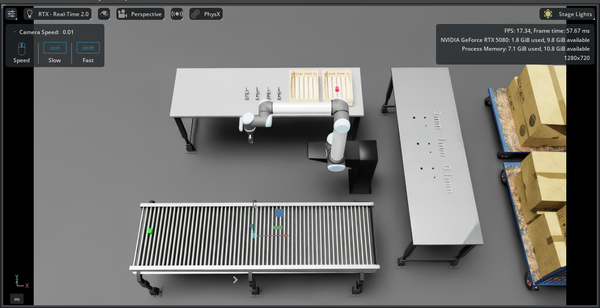
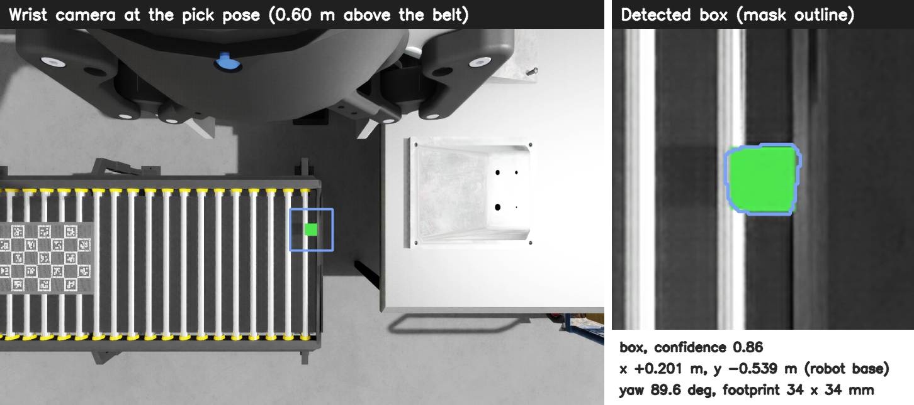
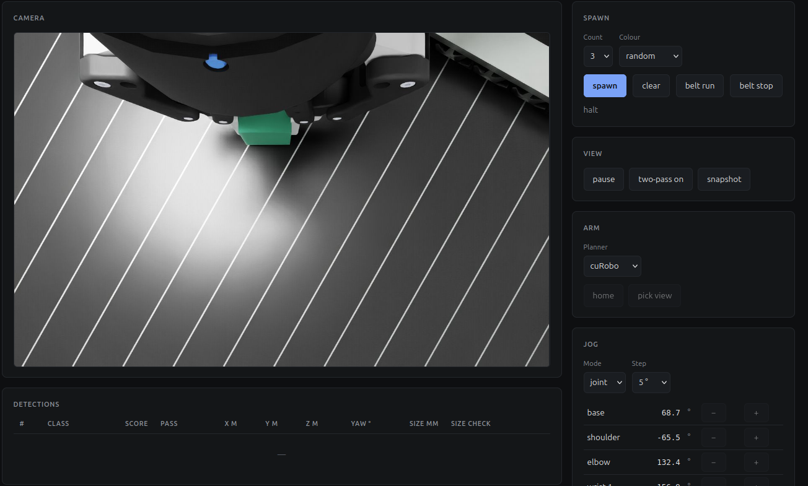
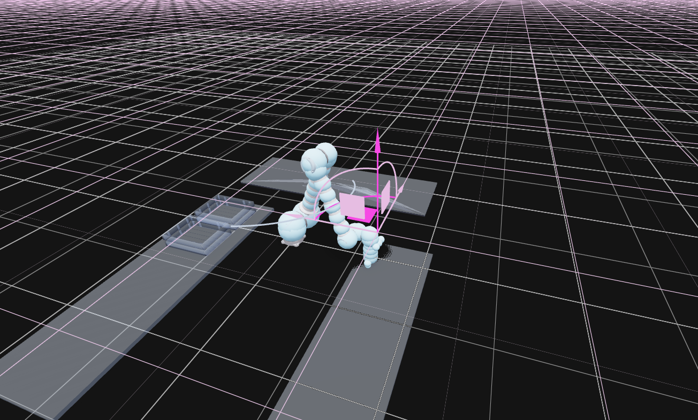

# Vision-guided UR10 pick and planner benchmark

A simulated work cell in NVIDIA Isaac Sim 6.0: a UR10 arm with a Robotiq 2F-85 gripper and a wrist-mounted RealSense
RGB-D camera. The robot finds boxes on a roller conveyor with a trained segmentation model, localises them in its own
base frame, plans a collision-free path and picks them. The same motions are planned three ways (RoboDK, NVIDIA cuRobo,
MoveIt 2) behind one planner interface, and benchmarked against each other.



## Perception

RF-DETR-Seg (Medium) fine-tuned on a synthetic dataset generated in Isaac Sim (2,600 frames, labels computed from
geometry and depth). A two-pass inference (normal + colour-inverted image) and a depth check keep black boxes and
rendering ghosts in line. Held-out test set: 694/695 boxes found, 0 false detections, mask IoU 0.944,
position error 1.5 mm, yaw error 0.4 deg.



## Operator page and pick

One command runs the whole pick: capture, detect, localise, choose a safe grasp, approach, straight-line descent,
close, lift, place. The operator page streams the wrist camera, spawns boxes, switches planner and jogs the arm.



## Planner benchmark

Frozen set of recorded pick queries, 30 repetitions each, same Cartesian steps and the same retiming for every
planner; each planner uses its own IK and collision checking. Empty scene, self-collision only (`evals/bench_planners_20261124_150421`).

| planner | motion | success | planning time ms |
|---|---|---|---|
| cuRobo | approach (free) | 100 % | 162.8 ± 29.6 |
| cuRobo | descent (linear) | 100 % | 169.6 ± 7.0 |
| cuRobo | return (free) | 100 % | 11.1 ± 0.9 |
| MoveIt 2 | approach (free) | 100 % | 29.8 ± 8.9 |
| MoveIt 2 | descent (linear) | 100 % | 6.2 ± 0.7 |
| MoveIt 2 | return (free) | 100 % | 20.1 ± 3.6 |



## Repository

| path | contents |
|---|---|
| `src/pipeline/` | s0 task manager, s1 mover, s2 capture, s3 detect, s4 localise, s4b grasp, s5 planner adapter |
| `src/lib/` | shared code; planner interface `planning.py` and the RoboDK / cuRobo / MoveIt backends |
| `src/tools/` | dataset generation, training, calibration, benchmark, referee tools |
| `src/ui/` | operator page |
| `config/cell.yaml` | the cell description every script reads |
| `cell.usd`, `floor.usdc`, `Conveyor.usdc`, `textures/` | Isaac Sim scene |
| `Conveyor.blend`, `assets/` | Blender sources of the scene |
| `cell.rdk` | RoboDK station |
| `models/` | detector training logs and config, MoveIt and cuRobo UR10 configs, collision meshes |
| `calib/` | hand-eye and gripper calibration results |
| `evals/` | detector and planner benchmark results |
| `runs/20261023_143258_pick/` | one complete pick run, every step's inputs and outputs |
| `report/` | progress reports and figures |
| `documentation/` | issues log, startup notes |
| `env/` | Python requirements, apt list, platform |

Not included (too large for GitHub): the training datasets (about 6 GB), the detector weights and the floor Blender file.

## Setup

Ubuntu 24.04, NVIDIA driver >= 580, ROS 2 Jazzy (`env/apt-ros-jazzy.txt`), Isaac Sim 6.0.0, RoboDK 6.0.6.

```bash
git clone https://github.com/shakshat27/ip_ws.git ~/ip_ws
python3 -m venv --system-site-packages ~/ip_ws/.venv_cv
~/ip_ws/.venv_cv/bin/pip install -c ~/ip_ws/env/constraints-cv.txt --extra-index-url https://download.pytorch.org/whl/cu130 -r ~/ip_ws/env/requirements-cv.txt
```
